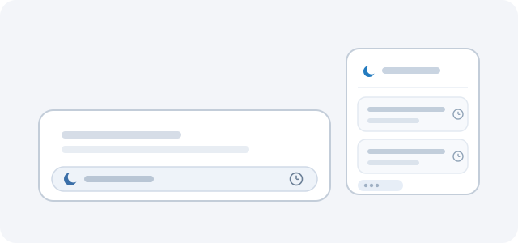

<div align="center">
  
</div>

# Deferred ask

[English](README.md) | [中文](README.zh.md)

Queue a question from the composer and let DSH send it only while DeepSeek bills at off-peak rates — half the peak price.

Write the question you would otherwise ask now, press `Ctrl+Enter`, and it waits. When the off-peak window opens, the question is delivered on its own, so nothing is left to remember at 22:00.

> [!WARNING]
> **The package on npm is `1.0.12`, and it installs but never appears.** Its browser bundle registers itself under `@local/dsh-deferred-ask` instead of the package name, and DSH's `client-modules` refuses to load an entry whose factory id does not match — so the bar under the composer never renders. The Host half is an empty `apply()`, which is why the Plugins page still reports **active** and the failure stays silent.
>
> `1.0.13` in the repository fixes it and cannot regress: `prepublishOnly` runs `scripts/check-bundle-names.mjs` and refuses to publish when the three names disagree. Until the version on npm catches up, [install from the repository](#install).

## Why it waits instead of scheduling ahead

DSH replays a scheduled task's missed occurrence on the next launch, and only the latest one. If the trigger were pinned at enqueue time (`timing: {kind: 'at'}`), that catch-up delivery could easily land inside a peak window and bill at full price.

So this plugin inverts the order: every 30 seconds it checks the clock, and only once the clock really is off-peak does it create a one-shot schedule that fires five seconds later. A question queued at noon on Tuesday is therefore delivered at 12:00:05, and one queued at 17:59 at 18:00:05.

## Pricing window

Asia/Shanghai (UTC+8, no daylight saving):

| Window | Billing |
| --- | --- |
| Mon-Fri 09:00–12:00 and 14:00–18:00 | peak (full price) |
| every other hour, including weekends | off-peak (peak × 0.5) |
| Chinese public holidays, all day | off-peak — but see the limit below |

No holiday calendar is bundled, so a public holiday is treated as an ordinary weekday: the question goes out after 18:00 rather than immediately, which is later than the cheapest moment but never more expensive.

## Usage

- **Queue**: `Ctrl+Enter`, or click **Defer to off-peak**. The queue lives in `localStorage` (`dsh.deferredAsk.queue.v1`) and survives reloads.
- **Delivery**: within 30 seconds of the window opening. The default target is a **new session**: the folder is resolved from the current session's workspace, then from `cwd` on the Host's session summaries, and finally from the folder pinned in the panel, which always wins.
- **Follow-up in place**: choose **Continue in this session** in the panel (stored as `"path": ""`) to force delivery into the current session; choose **Automatic** to release the pin.
- **Retry**: a failed delivery keeps the item and retries with exponential backoff (from 5 minutes up to 1 hour), showing the error text on the item. An item is never delivered twice concurrently.
- **Send now**: delivers immediately at peak price, useful for testing or for changing your mind.
- **Limit**: 50 queued items.

## Limits

- The discount applies to **per-token billing only**; a flat subscription sees no change.
- DSH must be **running** when the window opens. A closed app delivers on the next tick after it starts.
- A queued question is billed for its own tokens: moving it to off-peak halves the unit price, not the token count. Because it usually starts a fresh session, write it as a self-contained question rather than "continuing from that bug".
- The 30-second ticker only runs while DSH is open; nothing is scheduled into the OS.

## Install

Until `1.0.13` reaches the registry, install the repository — that source already carries the fix:

```sh
dsh plugin --profile <profile> add github:wangyz911/dsh-deferred-ask
```

Once the registry serves `1.0.13`, the plain package name works the same way:

```sh
dsh plugin --profile <profile> add dsh-deferred-ask
```

### Already installed `1.0.12`?

The bar never appears because the browser entry fails to load. Switching the source fixes it and replaces the npm copy in the profile:

```sh
dsh plugin --profile <profile> add github:wangyz911/dsh-deferred-ask
```

If you would rather keep the npm copy, exactly one line is wrong. In your profile's `node_modules/dsh-deferred-ask/client.js`, line 15 reads

```js
  id: '@local/dsh-deferred-ask',
```

and must read

```js
  id: 'dsh-deferred-ask',
```

The client watcher reloads the bundle within a second, so no restart is needed.

For a local checkout, add it as a link instead:

```sh
dsh plugin --profile <profile> add link:C:/path/to/dsh-deferred-ask
```

The bundle then appears in **Plugins** as **Deferred ask**; the bar shows up under the composer of a conversation.

## Implementation notes

For DSH plugin authors, the parts that are easy to get wrong:

- The browser artifact's `__ModuleLoader__.load({ id })` must equal the package name. A mismatch is not a warning — `client-modules` drops the whole entry with `loaded without registering "<name>" via __ModuleLoader__.load`, and when the Host half is a no-op `apply()` nothing else fails, so the plugin still looks **active** in the Plugins page while rendering nothing. `scripts/check-bundle-names.mjs` (wired into `prepublishOnly`) exists to make that unshippable.
- `inject` must list nested services in full — `['slots', 'locale', 'remote', 'remote.schedule', 'remote.session']`. Writing only `remote` fails later with `without inject` when `remote.schedule` is read.
- The working folder has three sources: the `workspaces` snapshot (`items[].sessionIds` plus `WorkspaceView.path`), `ctx.remote.session.list()`'s `SessionSummary.cwd`, and the pinned folder in `localStorage` (`dsh.deferredAsk.target.v1`). Either of the first two can be empty for some sessions, so the third exists.
- The picker has three states: no key means automatic, `{"path": ""}` means follow the current session (**overriding** automatic resolution), and `{"path": "D:\\..."}` pins a folder. An early version read the empty string as "no pin" and kept opening new sessions.
- The selector hooks offered for that slot (`useWorkspaces`, `useSession`) are typed `<S>(selector, equals?) => S`; calling them without a selector throws, which is why the folder is not read through them.
- The panel mounts at `conversation.composer.dock`, with a floating fallback at `shell.overlay` for when the dock is unavailable. `shell.overlay` runs in root scope with no `sessionId` in its props, so **Continue in this session** is refused there with a message rather than silently opening a new session.

## License

MIT — see [LICENSE](LICENSE).
